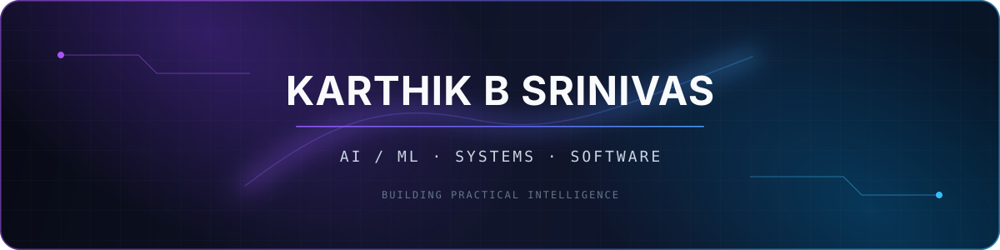

  

  

  AI/ML and software developer working across intelligent systems, Python, C++, and practical full-stack tools.
  I like projects where a sound model, retrieval pipeline, or synchronization algorithm becomes something people can actually run and inspect.

  

## Selected work

<table>
  <tr>
    <td width="50%" valign="top">
      <h3><a href="https://github.com/karthikbs01/smart-farm-audio-classifier">Smart Farm Audio Classifier</a></h3>
      
Farm-sound classification from audio files or a live microphone. It combines frozen WavLM embeddings with a logistic-regression classifier for five sound classes, with source-aware evaluation and a documented held-out accuracy of 86.4%.

      
<code>Python</code> <code>PyTorch</code> <code>WavLM</code> <code>scikit-learn</code>

    </td>
    <td width="50%" valign="top">
      <h3><a href="https://github.com/karthikbs01/dining-philosophers-simulator">Dining Philosophers Simulator</a></h3>
      
A C++17 concurrency lab with FIFO resource scheduling, atomic fork allocation, condition-variable waiting, and a live React dashboard backed by the same multithreaded simulation engine.

      
<code>C++17</code> <code>Threads</code> <code>CMake</code> <code>React</code> <code>SSE</code>

    </td>
  </tr>
  <tr>
    <td width="50%" valign="top">
      <h3><a href="https://github.com/karthikbs01/SahkarSaathi">SahkarSaathi</a></h3>
      
A multilingual voice and text assistant for cooperative laws, PACS services, crop insurance, and grievance guidance. Its RAG pipeline grounds answers in official documents and supports citation or abstention.

      
<code>FastAPI</code> <code>React</code> <code>FAISS</code> <code>RAG</code> <code>Bhashini</code>

    </td>
    <td width="50%" valign="top">
      <h3><a href="https://github.com/karthikbs01/PsySecure-AI">PsySecure AI</a></h3>
      
A local Flask application for multimodal cognitive-security analysis across pasted text, web links, and images, with cloud-assisted vision and a local OCR fallback.

      
<code>Python</code> <code>Flask</code> <code>Anthropic API</code> <code>Tesseract OCR</code>

    </td>
  </tr>
</table>

## Technical toolkit

  

  <strong>AI / ML</strong> — audio classification, embeddings, retrieval-augmented generation, evaluation 
  <strong>Systems</strong> — multithreading, synchronization, resource scheduling, native builds 
  <strong>Product</strong> — FastAPI and Flask backends, React interfaces, browser-connected tools

## GitHub snapshot

  <picture>
    <source media="(prefers-color-scheme: dark)" srcset="./assets/stats-dark.svg">
    <source media="(prefers-color-scheme: light)" srcset="./assets/stats-light.svg">
    
  </picture>
  <picture>
    <source media="(prefers-color-scheme: dark)" srcset="./assets/languages-dark.svg">
    <source media="(prefers-color-scheme: light)" srcset="./assets/languages-light.svg">
    
  </picture>

Language cards reflect repository code volume, not proficiency.

  
<strong>Contribution trail</strong>

   
  <picture>
    <source media="(prefers-color-scheme: dark)" srcset="https://raw.githubusercontent.com/karthikbs01/karthikbs01/output/github-snake-dark.svg">
    <source media="(prefers-color-scheme: light)" srcset="https://raw.githubusercontent.com/karthikbs01/karthikbs01/output/github-snake.svg">
    
  </picture>

---

  Building at the intersection of intelligent software and dependable engineering.

